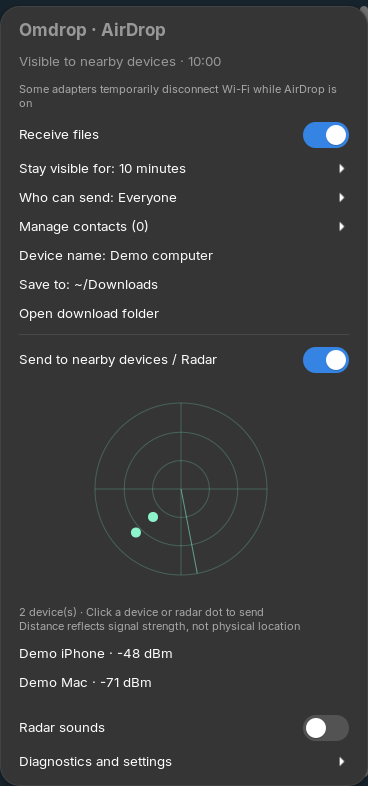
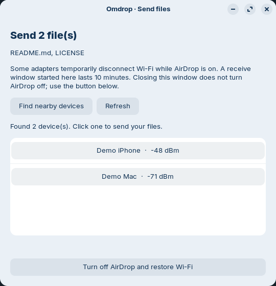

# Omdrop Desktop

A native GNOME interface for sending and receiving files with nearby Apple
devices through [Omdrop](https://github.com/brentkearney/omdrop-plugin).

Omdrop Desktop provides a **GNOME Shell panel extension** and a **Nautilus
right-click action with a GTK4 device picker**. The Omdrop CLI and a compatible
AWDL radio backend must be installed separately. This is an independent frontend,
not an official Omdrop or Apple release.

## Preview

<p>
  
  
</p>

These are screenshots of the actual frontend in an isolated GNOME session,
using an offline demo backend. Device names, file selections and radio status
are demonstration data, not evidence of a live Apple-device transfer.

## Features

- Receive switch, real visibility state, countdown and one-file/timed/manual receive windows.
- Everyone / Contacts Only, known-sender management, device name and save folder.
- Nearby-device list, signal-strength radar, file and web-link sending, progress and cancellation.
- `Send with Omdrop…` in Nautilus for one or more local files.
- Requirements diagnostics, identity status and transfer size limit.
- Shell UI in Chinese when the preferred session language is Chinese; English for all other languages.
- Nautilus menu and sending window in English.

Some Wi-Fi adapters, including the originally tested Intel AX201, require
exclusive mode: ordinary Wi-Fi disconnects while AirDrop is visible and the
radio backend restores it afterward. This frontend cannot remove that hardware
limitation. Check the radio backend's current compatibility table.

## Supported environment

| Component | Tested baseline |
| --- | --- |
| GNOME Shell | 46; only 46 is declared in extension metadata |
| Nautilus | 46.4 with the Nautilus 4 Python interface |
| Platform | Ubuntu 24.04 / Zorin OS 18.1 |
| Runtime | GJS, GTK4, system Python 3 with PyGObject |
| Backend integration | Omdrop CLI 0.16.1 + omdrop-owl 0.1.0 |

These baselines are not a claim that every Wi-Fi chipset or later GNOME version
works. The original user reported successful receiving; this public packaging
has automated and simulated tests, not a newly performed Apple-device transfer.

## Install

First install the [radio backend and Omdrop CLI](docs/BACKENDS.md).
On Debian/Ubuntu, frontend dependencies are:

```sh
sudo apt install gnome-shell gjs libglib2.0-bin python3-gi python3-nautilus \
  gir1.2-nautilus-4.0 gir1.2-gtk-4.0
```

From a checkout or extracted source archive:

```sh
sh scripts/install.sh
```

The installer is user-only and needs no `sudo`. It compiles the schema, installs
both frontends, and attempts to enable the Shell extension. A newly installed
extension may not be known to the current Shell. **On Wayland, log out and log
back in**, then enable it if needed:

```sh
gnome-extensions enable omdrop-desktop@local
```

Restart Files when no copy/move operations are running to load its Python menu.
The installer deliberately does not close your file manager or end your session.
You can install just one frontend:

```sh
sh scripts/install.sh --component shell
sh scripts/install.sh --component nautilus
```

See [migration notes](docs/MIGRATION.md) if you used the earlier private version.

## Use

**Panel:** click the Omdrop icon, choose a receive window, then enable receiving.
Opening the radar also opens a receive window when needed. Click a device or
radar dot to send files or a web link. Right-click the panel icon to toggle
receiving. A radar angle is decorative, not a physical bearing.

**Nautilus:** select local regular files, right-click and choose
**Send with Omdrop…**. Click **Enable AirDrop and find devices** if receiving is
off, then select a device. Folders must be compressed first; remote files must
be downloaded. The action is not shown on folders or empty space.

Set the recipient's AirDrop visibility to **Everyone** for a first test.
Sending to Contacts Only devices can require an Apple-issued AirDrop identity;
follow upstream documentation. An empty receive Contacts Only list refuses
everyone.

Closing a menu or sender window does **not** turn off an already-open receive
window. Turn receiving off explicitly, use **Turn off AirDrop and restore Wi-Fi**,
or wait for its timer. Disabling/uninstalling this frontend does not remove the
backend or your AirDrop identity.

## Configuration

The CLI is discovered in `$XDG_BIN_HOME/omdrop` (default `~/.local/bin/omdrop`)
and then `PATH`. For a custom installation, set `OMDROP_CLI` to its absolute
path in the desktop session environment before logging in. Shell sounds are
optional; `OMDROP_SOUND_DIR` may point to upstream's sound directory. No sounds
are included here.

The frontend does not ask for administrator credentials itself. Radio changes
are delegated to the separately installed backend's polkit helper. Do not run
the frontend as root.

## Uninstall

```sh
sh scripts/uninstall.sh
```

The installer only replaces its recognized files. Upgrades and removals preserve
recoverable copies under `$XDG_DATA_HOME/omdrop-desktop-backups/`. It never deletes
Omdrop certificates, contacts or backend settings. See [installation details](docs/INSTALLATION.md).

## Develop and build

```sh
make test
make package
# Optional isolated GTK4 UI test (requires xvfb):
sh scripts/test-ui.sh
```

`dist/` receives a GNOME extension zip and a source zip containing both frontends.
Only the Shell zip can be installed with `gnome-extensions install`; install the
source package with `scripts/install.sh` for Nautilus support.
Tests use a fake CLI and never turn on the real radio. Read [testing](docs/TESTING.md),
[contribution guidance](CONTRIBUTING.md) and the [publishing checklist](docs/PUBLISHING.md).

## License

[MIT](LICENSE), with [upstream attribution](NOTICE.md). External backends retain
their own licenses. Please do not include identities, private keys, contact lists
or packet captures in public bug reports.
